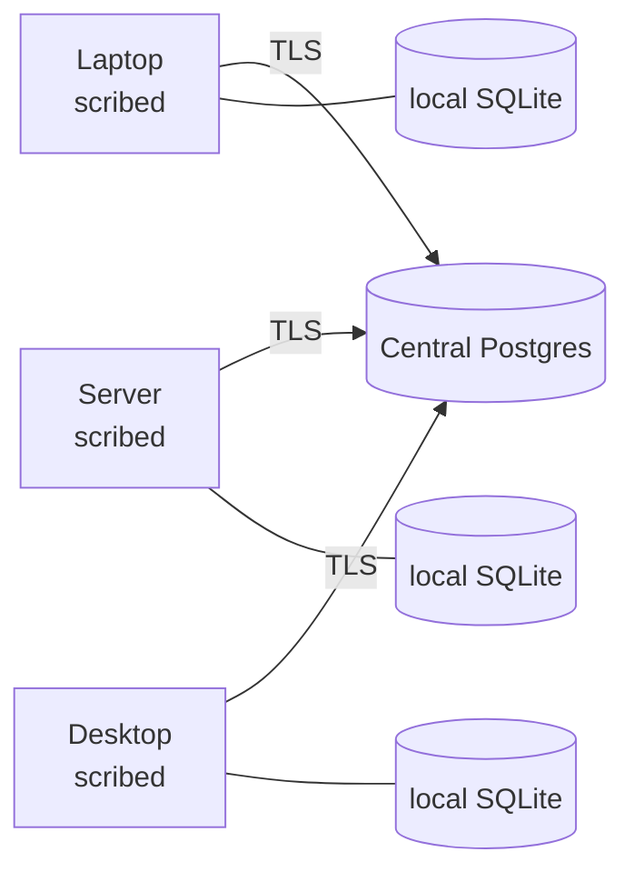

# Many computers, one database (Postgres)

Each computer keeps its own scribe as usual, and also sends its history to a central PostgreSQL
database. You can then look at all computers in one place, and their records survive even if a
computer is wiped.



What each computer has learned (known hosts, alerts) stays in its local SQLite. Only history (the
events you choose) goes to Postgres.

> **Status:** the Postgres history sink works and is tested against Postgres 16. Still to come:
> custom CA and client-certificate options, a ready-made least-privilege role, heartbeats, and a
> column naming the sending computer.

## 1. Get a scribed with Postgres

Release builds don't include Postgres yet. Build scribed with it:

```bash
cargo build --release -p scribe-daemon -p scribe-cli --features scribe-daemon/postgres
```

and install that build (`--from target/release` for the install scripts).

## 2. Prepare the database

As the database admin, create a database and one account for scribe:

```sql
CREATE ROLE scribe LOGIN PASSWORD '<a long random password>';
CREATE DATABASE scribe OWNER scribe;
```

scribed creates and upgrades its own tables on first connect, so the account needs to own the
database (or at least be allowed to create a schema in it).

## 3. Store the password on each computer

The password never goes in the config file. Put it in the system's secret store:

```bash
sudo scribed --set-secret keychain:scribe-postgres
```

Type the password and press Ctrl-D. Use `secret-service:scribe-postgres` on Linux desktops,
`dpapi:scribe-postgres` on Windows, or `file:/etc/scribe/postgres.pass` (a root-only file) on servers.

## 4. Add the sink to each computer's config

```toml
[[storage.sinks]]
name = "central"
kind = "postgres"
url = "postgres://scribe@db.example.com:5432/scribe"
credentials = "keychain:scribe-postgres"
schema = "laptop_anna"        # one per computer, see below
events = ["flow", "alert", "audit"]
retention = ""                # keep forever; or e.g. "365d"
```

Keep the local `local-history` sink too, so `scribe` still works offline.

**Give each computer its own `schema`.** Records don't yet say which computer sent them, so each
computer writes to its own schema (created on first connect): lower-case letters, digits and `_`.

Restart scribed, then check:

```bash
scribe status
```

The `storage` line should show `sink central: postgres ok`.

## How it behaves

- **Encrypted.** A database on another machine is always reached over TLS, with its certificate
  checked against the system's trusted certificates. `sslmode=disable` is refused for it.
- **Offline is fine.** If the database is away, events wait on disk (`[storage.spool]`) and are sent
  in order when it is back. `scribe status` shows `sink_spooling` meanwhile.
- **Batched.** Events are written in batches of up to 500, or every second (`batch_max_events`,
  `batch_max_wait`).
- **Safe upgrades.** Several computers can start at once; table upgrades take a lock so they run once.

## Looking at the data

Everything is in the `events` table of each schema. The details are in the `payload` column (JSON).

```sql
-- Alerts from one computer in the last day
SELECT ts, host, payload->>'reason' AS reason, payload->>'process_path' AS program
FROM laptop_anna.events
WHERE kind = 'alert' AND ts > now() - interval '1 day'
ORDER BY ts;
```

```sql
-- Hosts contacted most, by connections
SELECT host, count(*) AS connections
FROM laptop_anna.events
WHERE kind = 'flow' AND payload->>'kind' = 'new_flow'
GROUP BY host ORDER BY connections DESC LIMIT 20;
```

A view with `UNION ALL` over every computer's schema gives one list for all of them.
