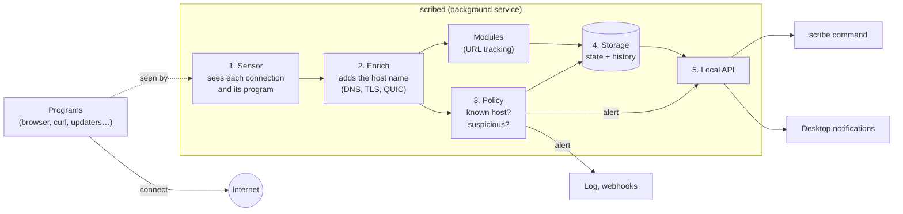

# How scribe works

scribe answers one question: **which programs on this computer talk to which hosts on the internet?**
It watches outgoing connections, remembers the hosts it has seen, and warns you about new or odd ones.
It only looks at who connects where; it never reads or decrypts what is sent.

## The parts

- **scribed** is the background service. It runs as root (or a service account on Windows) because
  watching connections needs system rights.
- **scribe** is the command you type (`scribe status`, `scribe hosts`, `scribe alerts`). It asks
  scribed over a local connection that only this computer can use.
- **scribe notify** runs in your desktop session and turns alerts into notifications.

## The picture

## Step by step

1. **Sensor: see the connection.** Each system has its own way to watch connections:
   - Linux: a small eBPF program in the kernel reports each new connection and the program that
     made it.
   - Windows: the system's event tracing (ETW) does the same.
   - macOS (and the fallback everywhere): packet capture sees the traffic, and scribed looks up the
     program in the system's list of open connections.
2. **Enrich: find the host name.** An IP address alone says little. scribed reads the name from the
   DNS answer that came before the connection, or from the first, unencrypted part of a TLS or QUIC
   handshake, where the browser names the site it wants.
3. **Policy: decide.** scribed checks the host against the list of known hosts (the *baseline*):
   - in **learn** mode it adds the host to the list;
   - in **caution** mode it scores the host (raw IP, odd port, random-looking name, threat list…)
     and alerts when the score is high, or when the connection isn't encrypted;
   - in **alert** mode it alerts on any host not on the list.
   Repeats are grouped, so you get one alert, not hundreds.
4. **Storage: remember.** What was learned (known hosts, alerts) goes to the *state* database. Every
   connection goes to one or more *history* databases: a local SQLite file, and optionally a central
   Postgres for many computers. If a database is away, scribed holds the data in memory or on disk
   and catches up later.
5. **Local API: answer.** The `scribe` command, notifications and future tools ask scribed over a
   Unix socket (Linux, macOS) or a named pipe (Windows). The system says who is asking, so scribed
   knows whether they may only read or also change things.

**Modules** add features without touching the core. The URL module records the addresses of
unencrypted web requests, with private parts removed.

## What keeps it safe

- **Nothing leaves the computer** unless you set up a webhook, a threat-list download or a central
  database.
- **Encrypted traffic stays encrypted.** scribed sees only the host name the program announces.
- **Changes are recorded.** Every change to scribed (mode, known hosts, pause) is stored in a chain
  of records that shows if someone edits or deletes them (`scribe audit verify`).
- **Pauses end.** `scribe daemon hibernate` always wakes up on its own, and the pause raises an alert.
- **Rights are dropped** where the system allows: on Linux the service runs in a systemd sandbox
  with only the rights it needs.

More detail, with the internal design, is in [`workfiles/diagram.md`](../workfiles/diagram.md) and
[`workfiles/specs.md`](../workfiles/specs.md).
