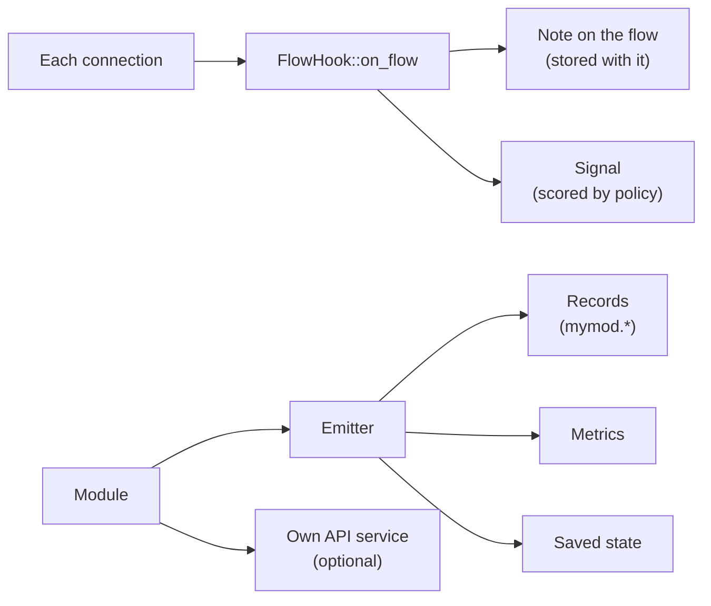

# Writing a module

A **module** adds a feature to scribed without changing its core: it looks at each connection and
can add notes, raise signals for alerts, store its own records and offer its own API calls. The URL
module ([`crates/module-url`](../crates/module-url)) is the working example; copy its layout.

Modules are compiled in (no plug-ins at run time) and turned on in the config:

```toml
[modules]
enabled = ["url", "mymod"]

[modules.mymod]
some_option = true
```

## What a module can do



| Output | How | Example |
|---|---|---|
| A note on the flow | `HookOutput::note(json)` | the URL of a plain web request |
| A signal for the policy | `HookOutput { signals: vec![Signal { reason: "mymod.odd_thing", .. }] }` | scored by `[policy.scores] "mymod.odd_thing" = 40` |
| Records | `Emitter::record` | `url.request` rows in the history |
| Metrics | `Emitter::metric` | counters shown by monitoring |
| State that survives restarts | `Emitter::put_state`; read back from `ModuleContext::state` | the last position read |

A module never touches storage, the network or the sensor directly. It only uses these outputs.

## Steps

1. **Create the crate** `crates/module-mymod`, depending on `scribe-module-api` and `scribe-core`.
2. **Describe it** with a `Manifest`: an id (`[a-z][a-z0-9_]*`, also the config section name), a
   version, and every record kind, metric and API call it has, each named `mymod.<name>`.
   `Manifest::validate` checks the names.
3. **Implement `Module`** (`crates/module-api/src/lib.rs`):
   - `configure` reads `[modules.mymod]` with `ConfigDoc::section::<YourConfig>("mymod")` (serde;
     errors keep their line in the file) and says if a change needs a restart;
   - `start`, `pause`, `resume`, `stop`, `health`;
   - `flow_hook` if it looks at connections, `source` if it works on a timer.
4. **Keep the hook fast and safe.** It runs for every connection, within a time budget, and gets
   untrusted bytes (`FlowContext::head`). It must never panic: a panic turns the module off. Read
   time only through `ModuleContext::clock`, never the system clock.
5. **Pass the conformance suite.** In `tests/functional/conformance.rs`, describe a valid config, a
   reload, bad configs with the line of the error, sample traffic and a time budget, and call
   `scribe_module_conformance::run_module_suite`. The suite also feeds random bytes to the hook.
   See [`crates/module-url/tests/functional/conformance.rs`](../crates/module-url/tests/functional/conformance.rs).
6. **Register it** in scribed: a Cargo feature in `crates/daemon/Cargo.toml` and one entry in
   `builtin()` in `crates/daemon/src/modules/mod.rs`, behind that feature.
7. **Optional API and CLI.** Put a service in `proto/scribe/v1/modules/mymod.proto`, serve it from the
   module crate behind a `server` feature, and add a `scribe mymod …` command behind a CLI feature,
   as the URL module does with `scribe url list`. Calls must be declared in the manifest as read or
   control; undeclared calls are refused.
8. **Document it**: the options in `config/scribe.toml` and [Configuration](configuration.md), a line
   in `changelog.md`.

## Rules

- New features go into a module, not into `core`, `storage-api` or the daemon.
- Test data uses documentation addresses (`192.0.2.0/24`, `2001:db8::/32`) and `example.com` /
  `example.net` only.
- Each test has exactly one tag; see [`workfiles/test-list.md`](../workfiles/test-list.md).
- Design details: [`workfiles/specs.md`](../workfiles/specs.md), section 7.4.
