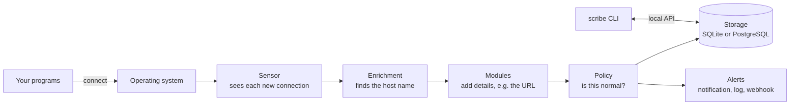
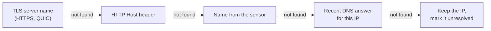
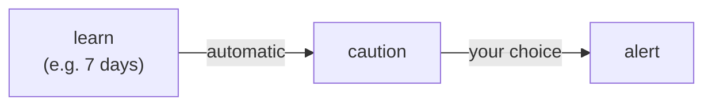

# scribe

[](https://github.com/savex/scribe/actions/workflows/tests.yml)
[](https://github.com/savex/scribe/actions/workflows/release.yml)
[](https://github.com/savex/scribe/actions/workflows/version.yml)
[](https://github.com/savex/scribe/actions/workflows/fuzz.yml)


**scribe watches every connection your computer makes to the outside world.**
It tells you which hosts are contacted, by which program, how often, and whether the traffic is encrypted.
It learns what is normal for your machine and warns you when something new or unusual appears.

> **Status: preview.** The building blocks are ready and tested, but scribe does not capture live traffic yet.
> See [Project status](#project-status).

## Why use it

- **See everything.** Every outgoing connection is recorded, including connections to bare IP addresses.
- **Know who did it.** Each connection is linked to the program that opened it (with the native sensors).
- **Spot surprises.** After a learning period, scribe alerts you about hosts it has never seen.
- **Catch unencrypted traffic.** Plain HTTP and other unencrypted connections are flagged.
- **Keep your data private.** scribe stores connection details only, never the content of your traffic.

## How it works

scribe has two programs:

- **`scribed`** is a background service. It watches the network, records what it sees and raises alerts.
- **`scribe`** is the command-line tool. You use it to look at the data and change settings.



### 1. The sensor sees a new connection

Each operating system has its own sensor. It reports the destination, the program and the first bytes the program sends.

| System | Sensor | Knows the program? |
|---|---|---|
| Linux | eBPF | Yes |
| Windows | ETW | Yes |
| macOS | Network Extension | Yes |
| Any of them | Packet capture (libpcap / Npcap) | No (fallback) |

### 2. Enrichment finds the host name

A connection starts with an IP address only. scribe looks for the real name in this order:



It also notes how the traffic is protected: **TLS**, **QUIC** or **plaintext**.
This is decided from the first bytes of the connection, never from the port number.
Some sites hide their real name with Encrypted Client Hello (ECH).
scribe then records the public name it can see and marks the connection as `ech`.

### 3. Modules add details

Modules are built-in features that you can switch on or off.
The first one is **URL tracking**. It records the address of each plain HTTP request.
More modules can be added later, for example kernel performance metrics.

### 4. The policy decides if it is normal

scribe keeps a list of known hosts, called the **baseline**. It works in one of three modes:

| Mode | What happens |
|---|---|
| **learn** | Records everything and fills the baseline. No alerts. |
| **caution** | Alerts on unknown hosts that look unusual, and on any unencrypted traffic. |
| **alert** | Alerts on every host that is not in the baseline. |

A typical setup learns for a week, then switches to caution by itself:



In caution mode, a host looks unusual when, for example, a program connects to a bare IP address,
uses an uncommon port, or uses a random-looking name.

### 5. Storage and alerts

- Data is kept in a local **SQLite** database by default. **PostgreSQL** can collect data from many machines.
- If storage is down for a while, scribe keeps the data on disk and sends it later.
- Alerts go to **desktop notifications** (`scribe notify`, started at login), the **log** and
  **webhooks** (JSON signed with HMAC-SHA256, HTTPS only). Repeated alerts for the same host are
  grouped, and each output is rate-limited, so you are not flooded.
- **Threat lists** can be local files or downloads, checked by a pinned hash or a minisign
  signature; a list that fails its checks never replaces the last good one.

## Privacy

- scribe never stores the content of your traffic. It stores who you talked to, when and how much.
- For plain HTTP, URL values are hidden by default. You choose how much of a URL is kept:

| Setting | `http://api.example.com/v1/users/1234?token=abc&lang=en` is stored as |
|---|---|
| `full` | `…/v1/users/1234?token=abc&lang=en` |
| `redact_values` (default) | `…/v1/users/1234?token=<redacted>&lang=<redacted>` |
| `strip` | `…/v1/users/1234` |
| `path_only` | `…/v1/…` |
| `hash` | `…/v1/users/1234?<hash:a41f9c>` (repeats can be matched, values cannot be read) |

- User names and passwords inside URLs are always removed.
- Data leaves the machine only if you set up a remote database or a webhook.
- Passwords and keys are never written in the config file. The config points to a protected file
  or to the system key store (macOS keychain, Windows DPAPI, Linux Secret Service);
  `scribed --set-secret <reference>` puts one there.

## Using scribe

Install packages are not published yet. Until then, build from source (see [For developers](#for-developers)).

Check your settings, then start the service:

```sh
scribed --check-config                     # show the settings in use and exit
scribed --config /etc/scribe/scribe.toml   # run until stopped
```

Daily use (`scribe` talks to `scribed` over a local socket; members of the `scribe` group may read,
root and `scribe-admin` may also change things):

```sh
scribe status                       # is scribed running, and how busy is it?
scribe hosts                        # hosts seen, with counters and flags
scribe hosts --hourly example.com   # one host's traffic per hour
scribe mode caution                 # switch mode
scribe alerts                       # list alerts, with the URL for plaintext requests
scribe alerts ack 12                # stop an alert from repeating
scribe alerts --watch               # new alerts as they happen
scribe notify                       # desktop notifications (see packaging/README.md for login)
scribe baseline add example.com     # mark a host as known
scribe url list --host example.com  # plaintext requests the URL module stored
scribe daemon hibernate --for 30m   # pause processing for a while
scribe daemon health                # healthy / degraded / unhealthy, for scripts
scribe audit verify                 # check the tamper-evident audit trail
```

Most commands take `--json`.

### Configuration

scribe reads one file, `scribe.toml`. An empty file is fine: every setting has a safe default.

| System | Default location |
|---|---|
| Linux | `/etc/scribe/scribe.toml` |
| macOS | `/Library/Application Support/scribe/scribe.toml` |
| Windows | `scribe.toml` next to `scribed.exe` |

A small example:

```toml
mode = "learn"

[policy]
learn_for = "7d"      # learn for a week ...
then = "caution"      # ... then switch to caution

[modules.url]
query = "redact_values"
```

Every setting is explained in [config/scribe.toml](config/scribe.toml).

## Project status

| Part | State |
|---|---|
| Configuration, logging, service start and stop | Done |
| Module framework and URL tracking | Done |
| Local storage (SQLite), buffering and retention | Done |
| Host names from TLS, QUIC, HTTP and DNS | Done |
| Policy engine and alert rules | Done |
| The daemon pipeline: counters, alerts, hibernation, config reload, audit trail | Done |
| Running as a service (systemd, launchd, Windows) | Done |
| Live capture with the pcap sensor (every system), with the process of each connection from the system's socket table | Done |
| Command-line queries and the local API (Unix socket, Windows named pipe) | Done |
| Alert outputs (notifications, log, webhook), threat-list downloads, OS key stores | Done |
| Native sensors for Linux, Windows and macOS (every connection, even the shortest, with its process) | Planned |
| PostgreSQL, installers | Planned |

Details: [workfiles/status.md](workfiles/status.md) and [workfiles/plan.md](workfiles/plan.md).
Changes: [changelog.md](changelog.md).

## For developers

scribe is a Rust workspace (Rust 1.89 or newer).

Build scripts for each system (`doctor` lists what's missing):

```sh
scripts/build/macos.sh check          # macOS, also from Xcode; release → dist/
scripts/build/linux.sh check          # Linux in a container on macOS (Apple container, docker or podman)
scripts/build/linux.sh --native test  # Linux directly (CI runner, WSL2)
```

```powershell
pwsh -File scripts\build\windows.ps1 check   # Windows x64
```

Or with cargo directly:

```sh
cargo build                                           # SQLite storage only
cargo build --features postgres                       # add PostgreSQL
cargo nextest run --workspace --all-features          # all fast tests (or: cargo test)
cargo run -p scribe-test-support --bin gen-fixtures   # regenerate test captures and fuzz seeds
```

For a local run, keep data in a folder you own and log to the terminal:

```toml
data_dir = "/tmp/scribe"
[log]
file = ""
```

```sh
SCRIBE_LOG=debug cargo run --bin scribed -- --config my.toml
```

Exit codes: `0` success, `1` failure, `2` usage or configuration error.

### Code layout

```
crates/
  core/                 shared types: flow events, modes, sensor interface, clock
  enrich/               host names from TLS, HTTP, DNS and QUIC; security detection
  secrets/              secret references and key generation
  sensor-linux/         eBPF sensor (Linux)
  sensor-windows/       ETW sensor (Windows)
  sensor-pcap/          libpcap / Npcap fallback
  storage-api/          storage interfaces
  storage-manager/      writers, spool, outage buffer, cache
  storage-sqlite/       default storage
  storage-postgres/     PostgreSQL storage (feature `postgres`)
  module-api/           interface for modules
  module-url/           URL tracking module (feature `url`, on by default)
  *-conformance/        test suites every storage backend, sensor and module must pass
  test-support/         test helpers, packet builders, fixture generator
  daemon/               the scribed service
  api/                  local API: protocol, socket / named-pipe transport, caller identity
  cli/                  the scribe command
proto/                  gRPC protocol files
macos/                  Network Extension (planned)
ui/                     optional desktop app (planned)
config/                 default configuration
testdata/               sample captures, scenarios, database snapshots
fuzz/                   fuzz targets and seeds
tests/                  smoke, integration and scenario tests
workfiles/              specification, plan, diagrams, test approach, status
```

To add a feature, write a module in `crates/module-*` that passes `scribe-module-conformance`
(design: [workfiles/specs.md](workfiles/specs.md) section 7.4).
How tests are organised: [workfiles/test-approach.md](workfiles/test-approach.md) and
[workfiles/test-list.md](workfiles/test-list.md).
Agreed decisions and config values: [.claude/skills/scribe-conventions/SKILL.md](.claude/skills/scribe-conventions/SKILL.md).
Rules for AI assistants: [CLAUDE.md](CLAUDE.md).

### Versions and releases

Versions come from git tags (`v1.2.0`, `v1.3.0-rc.1`). `scribe --version` shows the nearest tag,
for example `1.2.0+3.gabc1234` three commits after `v1.2.0`.
Use [`scripts/version.sh`](scripts/version.sh) to check versions; `scripts/version.sh versions` shows whether
the latest tag, `Cargo.toml` and `changelog.md` agree.

To release, run the **Bump version** workflow. It picks the next version after the highest one it knows,
writes it to `Cargo.toml` and `changelog.md`, tags `main` and starts **Release**, which builds
Linux, macOS and Windows binaries and publishes a GitHub Release.

### CI workflows

| Workflow | Runs on | What it does |
|---|---|---|
| Tests | manual | Format, lint, minimum Rust version, tests on 3 systems, SQLite and PostgreSQL |
| Release | `v*` tag | Verify, test, build, publish |
| Version tracking | push to `main` | Checks `Cargo.toml` against tags |
| Bump version | manual | Next version, changelog section, tag, start Release |
| Sensor tests | manual | Sensor suite with real privileges on 3 systems |
| Fuzz | manual | Fuzzes the packet parsers |
| UI tests | manual | Desktop app against a mock API |
| End-to-end | manual | Install, modes, upgrade and uninstall from release packages |
