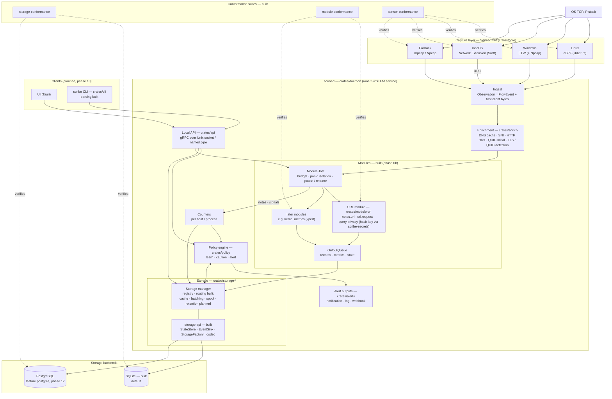
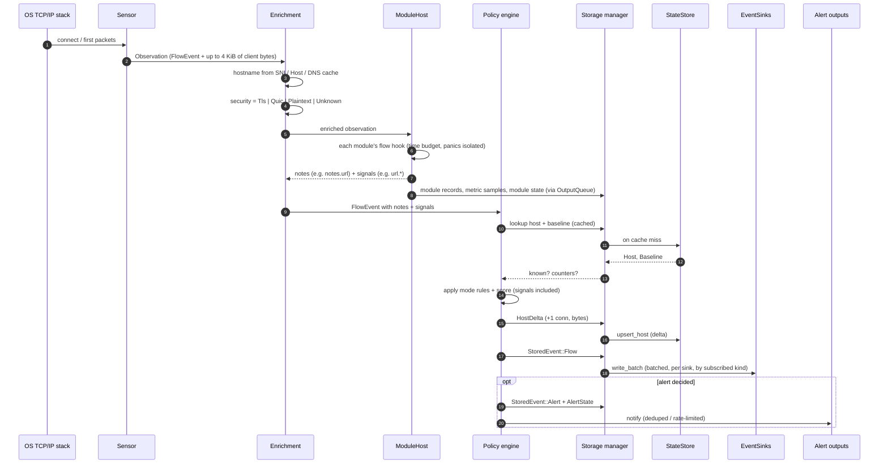
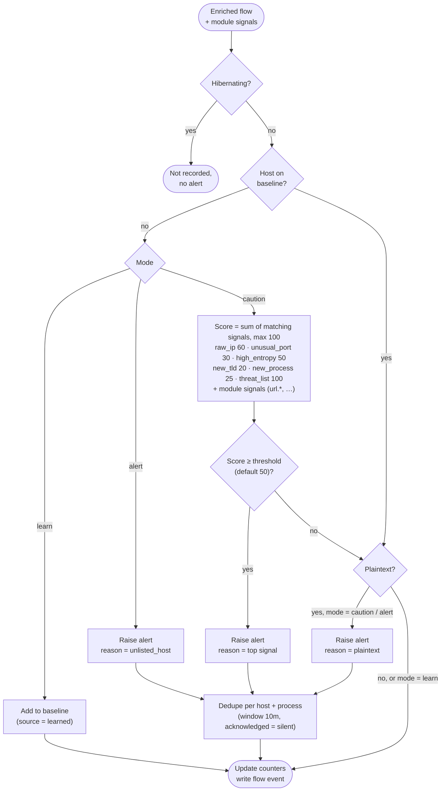
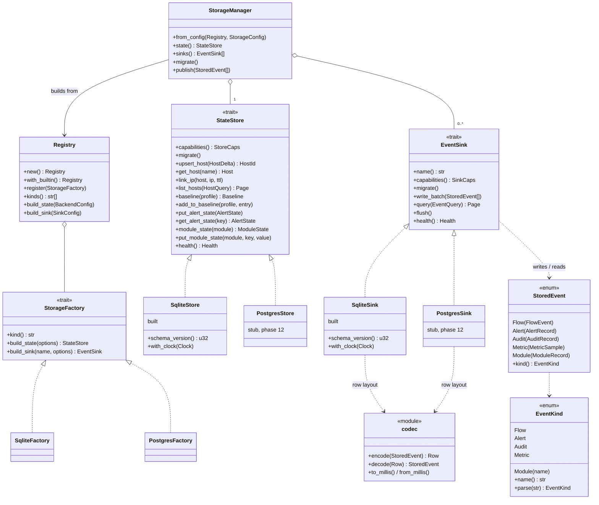
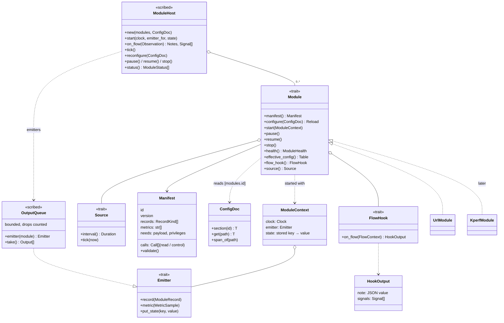
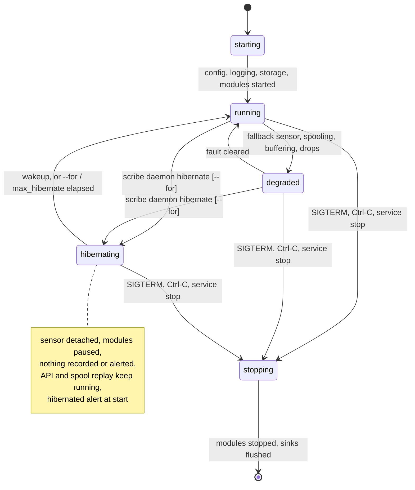
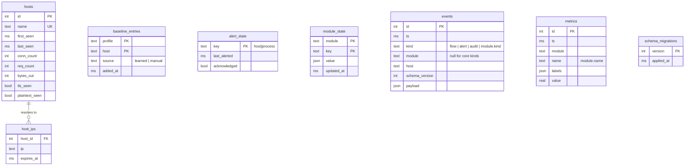
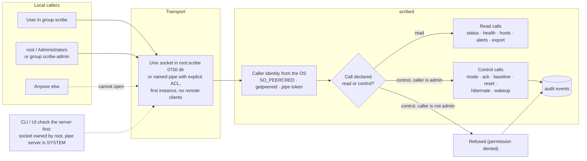

# scribe program diagrams

*Last updated 2026-11-22, after phase 1. Built parts are drawn with solid borders in the text and
marked **built**; everything else is planned. Details: [specs.md](specs.md), progress:
[status.md](status.md).*

| # | Diagram | Shows |
|---|---|---|
| 1 | Components | Crates and how data moves between them |
| 2 | Flow of one connection | One outgoing connection from the kernel to storage and alerts |
| 3 | Policy decision | How a mode turns a flow into a record or an alert |
| 4 | Storage classes | Storage interfaces, registry, manager, backends, row codec |
| 5 | Module framework | Module interface and the daemon's module host |
| 6 | Daemon run states | Running, degraded, hibernating, stopping |
| 7 | Stored data (schema v2) | Tables in the state store and event sink files |
| 8 | Local API trust boundary | Who may call what, and how it is checked |

## 1. Components

## 2. Flow of one outgoing connection

## 3. Policy decision

## 4. Storage classes

## 5. Module framework

`scribe-module-conformance` checks every module (manifest, config lines, reload, restart, pause,
time budget, random payloads, declared outputs) before it joins `scribe_daemon::modules::builtin()`.

## 6. Daemon run states

Planned for phase 5 (specs 8.5); `ModuleHost` already provides pause, resume and stop.

## 7. Stored data (schema v2)

`state.db` holds the state store tables, `events.db` the event sink tables (one file can hold both).
Timestamps are epoch milliseconds in SQLite and `TIMESTAMPTZ` in Postgres.

## 8. Local API trust boundary

Planned for phase 10 (specs 6.3, 12.1.1).

